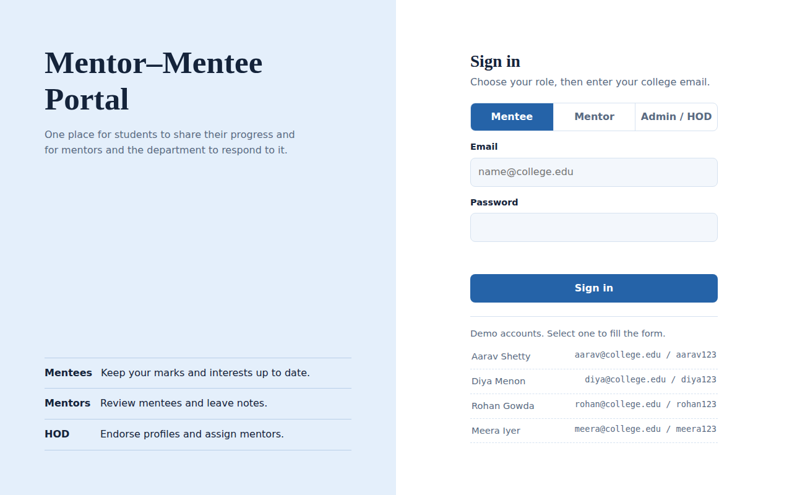
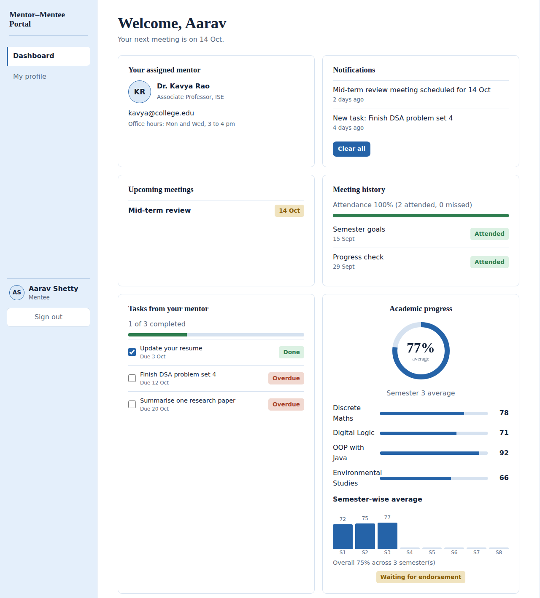
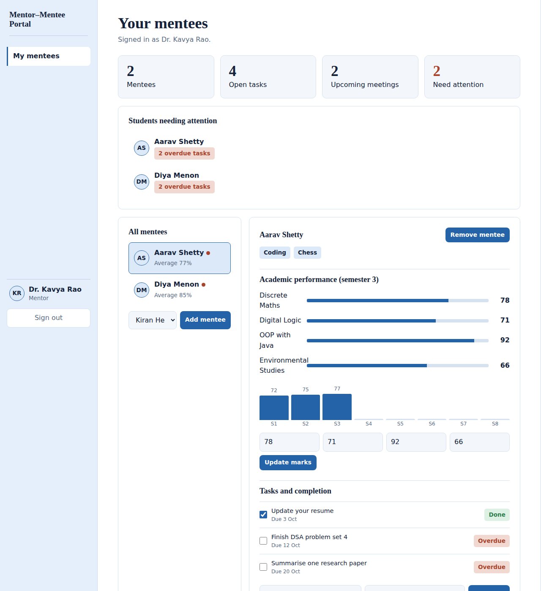
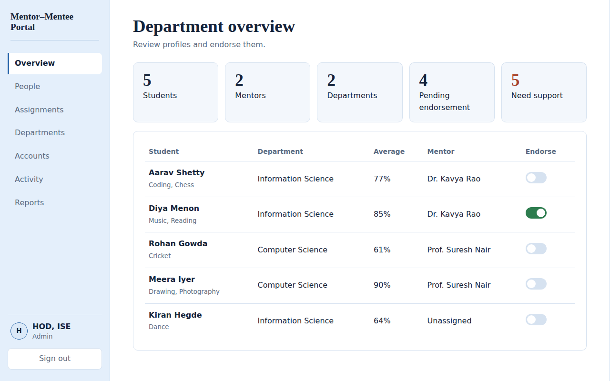

# Mentor-Mentee Portal

A role-based web app where students, mentors and the Head of Department (HOD) keep mentoring in one place. Built with HTML, CSS and JavaScript on a Supabase backend (PostgreSQL, Auth, Edge Functions) and hosted on Netlify.

## Features
- **Mentee:** assigned mentor, upcoming meetings and attendance history, tasks with completion, semester-wise marks (all 8 semesters) with chart, skills, goals, mentor feedback, notifications.
- **Mentor:** assigned mentees, add or remove mentees, schedule and mark meetings, give tasks, track completion, send feedback, update marks, "needs attention" list.
- **Admin / HOD:** add mentors and students, departments, assign mentors, manage accounts, monitor activity, reports with CSV download.
- **Security:** Row Level Security and triggers in PostgreSQL; the secret key lives only in the Edge Function.

## Screenshots
Taken from the demo build with sample data (same interface as the Supabase version).

| | |
|---|---|
|  |  |
|  |  |

## Setup

Files
- `index.html`: the whole app (sign-in, three dashboards, admin panel)
- `supabase/schema.sql`: tables, security rules, helper functions
- `supabase/functions/admin-users/index.ts`: admin-only function that creates accounts, disables them and resets passwords

## 1. Create the project
1. Go to supabase.com, create a project, and wait for it to finish starting.
2. **Authentication > Sign In / Providers > Email**: turn OFF "Allow new users to sign up". Only the admin should create accounts.

## 2. Create the database
1. Open **SQL Editor > New query**, paste all of `supabase/schema.sql`, and click Run.

## 3. Create the first admin (HOD)
1. **Authentication > Users > Add user > Create new user**. Enter your email and a password, and tick **Auto Confirm User**.
2. In the SQL Editor run (use the same email):
```sql
insert into profiles (id, role, name, email, dept)
  select id, 'admin', 'HOD', email, 'Information Science' from auth.users where email = 'YOUR_EMAIL';
```

## 4. Deploy the admin function
Easiest way (no tools to install):
1. In Supabase open **Edge Functions > Deploy a new function > Via Editor**.
2. Name it exactly `admin-users`, delete the sample code, and paste all of `supabase/functions/admin-users/index.ts`.
3. Click **Deploy**. Leave "Verify JWT" on.

Command-line alternative (needs Node.js), run inside this folder:
```
npx supabase login
npx supabase link --project-ref YOUR_PROJECT_REF
npx supabase functions deploy admin-users --use-api
```
The service role key is added to the function automatically. Never put it in `index.html`.

## 5. Connect the app
In `index.html`, find the CONFIG line and paste your **Project URL** and **anon public key** (Project Settings > API). The anon key is meant to be public; the security rules in `schema.sql` protect the data.

## 6. Put it online
Upload the folder to Netlify (drag and drop), Vercel, or GitHub Pages, then add that web address under **Authentication > URL Configuration > Site URL**.

## 7. Try it
1. Sign in on the Admin / HOD tab, add a mentor, a department if needed, and a student, then assign them.
2. Sign out and sign in as each of them.

## Notes
- Marks, tasks, meetings, skills, goals and notifications are stored as JSON on each student's row, so there are only four tables.
- Mentors can see unassigned students so they can add them. Everyone signed in can read names, emails and departments (a college directory); nothing else is shared.
- Students cannot change their own mentor or endorse themselves. Mentors cannot endorse. These rules are enforced in the database, not just on screen.
- Passwords are handled by Supabase Auth and are hashed. Nothing is stored in the page.
- The Claude preview link cannot talk to Supabase, so this version must be hosted on your own site.
